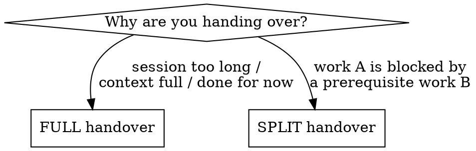

# Handover Prompt

## Overview

A handover hands a piece of work to an agent that has **zero context** — not you in five minutes, a stranger. The receiving agent knows nothing you haven't written down. Everything in your head — the decisions already made, the dead ends, the exact file you were in, the one thing they must not break — is lost unless it's on the page.

**Core principle:** Write for an agent with amnesia. If a fact isn't in the handover, it does not exist.

This skill produces **two artifacts every time**:
1. A saved **handover document** (markdown). Put it wherever this project keeps handovers — if there's an existing convention (e.g. auntyskitchen uses `docs/superpowers/plans/YYYY-MM-DD-<topic>-handover.md`), match it; otherwise a sensible `docs/` or repo-root location named `<date>-<topic>-handover.md`.
2. A short **paste-ready kickoff prompt** the user copies into the fresh agent/session to start it.

## The two modes



**FULL handover** — the session has run too long, context is filling, or you're stopping. The whole task moves to a fresh agent. The handover covers *everything* and the new agent owns it end-to-end.

**SPLIT handover** — you're on Work A, but Work A can't proceed until Work B (a prerequisite) is done. You stay on A (or pause it); a *separate* agent takes B. The handover you write is **only about B**, and it must be explicitly scoped so the B-agent does **not** wander into A. It tells the B-agent: here's the narrow job, here's why it unblocks A, here's what "done" looks like, and **report back when finished** so A can resume.

In both modes you only *prepare* the handover. **You do not launch the second agent** — you hand the user the kickoff prompt and they launch it.

## What EVERY handover must contain

Miss any of these and the fresh agent guesses — and guesses wrong. This is the checklist a no-skill agent fails (it writes "status / next steps / files" and stops). Create a TodoWrite item per section so none is skipped.

1. **One-line state** — what is true right now, in a sentence. ("Migration written + applied to preview; API done; UI half-built; 2 tests red.")
2. **The job in a sentence** — what "done" looks like for the receiving agent. For a SPLIT, this is *only* Work B.
3. **First actions** — the literal first commands, copy-pasteable, for *this* project's setup ritual: sync, branch/worktree, environment files, install deps. Whatever a fresh checkout needs before it can build or test. (Example, auntyskitchen: `git fetch origin --prune`, worktree off `origin/dev`, `cp ../../.env.test .env.test`, `npm install`.) Without this the agent trips on the project's worktree/env rules.
4. **What's already done / shipped** — with PR numbers and commit SHAs where they exist. So the agent doesn't redo it.
5. **What's locked vs open** — decisions already confirmed with the user (don't relitigate) vs. genuine open questions (must ask before acting).
6. **Real, verified file paths** — paths you actually opened, with line numbers if useful, plus the caveat "re-verify line numbers, they drift." **Never invent a path.** Hallucinated paths are the single most common handover failure — if you're not sure a path is real, grep for it before writing it down, or say "find the file that does X."
7. **Guardrails — what NOT to do** — the load-bearing "do NOT": don't write a second write path, don't touch Work A (split mode), don't claim success without a real end-to-end check. This is where you encode the traps you already hit.
8. **How to verify it actually works** — the concrete proof step (run this test, do this real scan, check this DB row). Tie to CLAUDE.md §7: no "it's fixed" without evidence.
9. **Project obligations** — whatever this project requires to be done alongside the code, surfaced so the next agent can't miss it. (In auntyskitchen that's: migration file as a clickable link + which DB(s) it must hit and *before* what; the relevant CLAUDE.md gates; release-note + support-doc asks; the memory file to update. Other projects will have their own checklist — carry over whatever applies.)
10. **Repo state at handover** — which branch the main checkout is on, which worktrees exist or were torn down, anything left uncommitted.

For a **SPLIT handover**, add two more:
11. **Why B unblocks A** — one or two sentences so the B-agent understands the stakes and doesn't over- or under-build.
12. **Report back** — "when B is done, report X back so A can resume" (the SHA, the new endpoint name, the migration version — whatever A is waiting on).

## The handover document template

Use `handover-template.md` in this skill directory as the skeleton. Fill every section; if a section genuinely doesn't apply, write "N/A — <reason>" rather than deleting it (silence reads as "forgotten").

## The paste-ready kickoff prompt

After saving the doc, output a short block the user copies into the fresh agent. Keep it tight — it points at the doc, it doesn't repeat it:

```
You're picking up <one-line job>. Full context is in
docs/superpowers/plans/<file>.md — read it first, before anything else.

First actions are in that doc's "First actions" section (the project's
setup ritual — branch/worktree, env files, install). Do those, then start
on <the job>.

Do NOT <the single most important guardrail>.
When done, <report-back instruction>.
```

For a FULL handover, drop the report-back line. For a SPLIT, keep it — that's how Work A learns it can resume.

## Common mistakes

| Mistake | Fix |
|---|---|
| Inventing file paths the agent then can't find | Only cite paths you opened; grep to confirm, or say "find the file that does X" |
| "Next steps: finish the UI" (vague) | Concrete: which file, which behaviour, how to know it's done |
| No first-actions, so the agent skips this project's setup ritual | Always include the copy-pasteable first commands for this repo |
| Listing what's done but not what's **decided** | Separate "locked (don't relitigate)" from "open (must ask)" |
| No guardrails, so the agent redoes or breaks something | Spell out the "do NOT"s — especially "don't touch Work A" in split mode |
| Claiming the work is "ready" without a verify step | Always include the concrete proof the next agent must run |
| Split handover that bleeds into Work A's scope | State Work B's boundary explicitly and the report-back contract |
| Deleting an inapplicable section | Write "N/A — <reason>" so it reads as considered, not forgotten |

## Real-world impact

The auntyskitchen project already runs on handovers — a dozen `docs/superpowers/plans/*-handover.md` files. The good ones (e.g. the invoice-scanner timeout handover) let a fresh agent resume a multi-task initiative cold. The pattern they share is exactly the checklist above: one-line state, first actions, locked-vs-open, real paths, guardrails, a verify step, and the repo state at handover. That same skeleton works on any project — only the project-specific obligations and setup ritual change.
